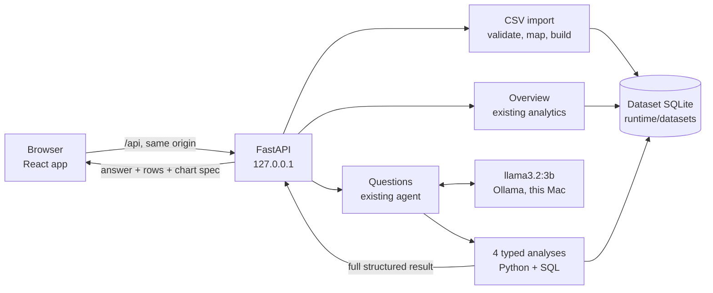

# MolarMetrics

**Understand your dental practice.**

MolarMetrics turns a dental clinic's own records (appointment, treatment and payment CSV exports)
into a clear overview and answers plain-English questions about them. It is a **local application**:
it runs on your Mac, keeps uploaded data on your Mac, and answers questions with a small language
model running on the same Mac (`llama3.2:3b` via [Ollama](https://ollama.com)).

> **Status: local prototype.** It is built for one person exploring clinic data on their own
> computer. It is **not** ready for public hosting or real multi-clinic production use (see
> [Limitations](#limitations)). It describes clinic *operations*: it does not diagnose, recommend
> treatments, or measure clinical quality.

---

## Contents

1. [Quick start (macOS)](#quick-start-macos)
2. [Upload your first CSV](#upload-your-first-csv)
3. [What you can upload](#what-you-can-upload)
4. [How uploaded data is stored and deleted](#how-uploaded-data-is-stored-and-deleted)
5. [Privacy and security model](#privacy-and-security-model)
6. [How it works](#how-it-works)
7. [Metric definitions](#metric-definitions)
8. [Running the tests](#running-the-tests)
9. [Verification status](#verification-status)
10. [Limitations](#limitations)
11. [Troubleshooting](#troubleshooting)
12. [The sample dataset](#the-sample-dataset)
13. [The earlier Streamlit app](#the-earlier-streamlit-app)
14. [Project structure](#project-structure)

Developer details (the question pipeline, the import internals, API contracts, dependency policy)
are in [`docs/developer.md`](docs/developer.md).

---

## Quick start (macOS)

**Already set up on this Mac?** Two commands:

```bash
cd ~/Desktop/MolarMetrics
./scripts/start.sh --open          # builds the web app if needed, serves http://127.0.0.1:8000
```

Stop it with **Ctrl+C**. Questions need Ollama running (open the Ollama app, or run `ollama serve`);
everything else works without it.

### First-time setup

Requirements: Python 3.13, Node.js 22 (or newer), and Ollama with `llama3.2:3b`.

```bash
cd ~/Desktop/MolarMetrics

# Python environment (once). Skip the first line if .venv already exists.
/Library/Frameworks/Python.framework/Versions/3.13/bin/python3.13 -m venv .venv
.venv/bin/python -m pip install -r requirements.txt

# Web app packages (once; installed into web/node_modules, never globally)
cd web && npm ci && cd ..

# The local model (only if `ollama list` doesn't show it; about 2 GB)
ollama list
ollama pull llama3.2:3b
```

Then `./scripts/start.sh --open`.

### Development mode (hot reload)

```bash
./scripts/dev.sh                   # API on 127.0.0.1:8000 (auto-reload) + web app on 127.0.0.1:5173
```

Open **http://127.0.0.1:5173**. The web dev server forwards `/api` requests to the API, so the
browser only ever talks to one address. Or run the two halves yourself in two terminals:

```bash
.venv/bin/python -m molarmetrics.api --reload     # terminal 1
cd web && npx vite                                # terminal 2
```

Both servers listen on `127.0.0.1` only. The API refuses to start on any other address.

---

## Upload your first CSV

1. Open the app. With no data yet you see **Understand your dental practice.**
2. Export **appointments** from your clinic software as CSV. That one file is enough for appointment
   figures (completed visits, no-show rate, patients seen). Add **treatments** for billed revenue and top
   procedures, and **payments** for collections and outstanding balances. **Patients** and **dentists**
   files are optional extras.
   * Not sure about the layout? Click **Download templates**: one template per record type, each
     explaining what one row represents, plus a small example clinic.
   * Use patient **codes**, not names or phone numbers. Columns you don't map are never stored.
3. Drop the files on the page, or click **Choose files**. Check the list (you can remove files), then
   **Upload and review**.
4. On **Review your data**, check each file:
   * **This file contains**: the record type (suggested from the file).
   * **Columns**: which file column is which field. Required fields are marked; suggestions are
     pre-filled for you to confirm or correct.
   * **Date format**: if dates such as `03/04/2025` could be day-first or month-first, choose the
     format your clinic uses. (Your choice also fills in other ambiguous date columns; each can be
     changed.)
   * **Amounts**: confirm whether money is in **rupees** (`1500.50`) or **paise** (`150050`). The page
     shows how the first values will be read.
   * **Appointment statuses**: match labels such as *Attended* or *DNA* to completed, cancelled or
     no-show.
   * **Needs your review**: payments dated before their treatment, and treatments on cancelled or
     no-show appointments, must be explicitly **included as recorded** or **left out**. The decision is
     recorded and shown with the results.
   * **Checks** lists every problem with its spreadsheet **row number** (the header is row 1) and a
     suggested fix. **Download issues report** saves the full list as CSV.
5. When **Ready to import** appears, give the dataset a name and click **Import data**. You land on
   the **Clinic overview**.

To look around first, click **Explore sample data** (a fictional clinic). Sample data is never loaded
unless you ask, and a small **Sample data** label shows while it is active.

On **Ask MolarMetrics**, try a suggested question or type your own, for example *"Compare monthly
billed revenue and collections in 2025."* Each answer shows a chart and table built from the
calculated results, **View supporting data**, **How this is calculated**, and **Download results**.

---

## What you can upload

| File | One row is | Required columns | Adds |
|---|---|---|---|
| **Appointments** (required) | one booked appointment: completed, cancelled or missed | Appointment ID, Patient ID, Appointment date, Status | completed visits, no-show rate, patients seen, results by dentist (with a Dentist ID column) |
| **Treatments** | one procedure billed at one appointment (a line item) | Treatment ID, Appointment ID, Procedure, and Net fee *or* Listed fee | billed revenue, top procedures |
| **Payments** | one payment received against one treatment | Payment ID, Treatment ID, Payment date, Amount | collections, outstanding balances |
| **Patients** | one registered patient (by code) | Patient ID | checks that every appointment's patient exists |
| **Dentists** | one dentist | Dentist ID | dentist names in results; checks dentist codes |

* **Formats accepted:** comma, semicolon or tab separated; UTF-8 (or Windows text). Dates: `2025-04-03`,
  `03/04/2025`, `04/03/2025`, `03-04-2025`, `03.04.2025`, `2025/04/03`, `3 Apr 2025`, `Apr 3, 2025`,
  optionally with a time. Money: `1500`, `1500.50`, `1,500.50`, `1,23,456.78`, `₹1,500`, `Rs. 1500`.
* **Limits:** up to 10 files per upload, 20 MB each, 200,000 rows and 100 columns per file.
* **Exact money:** amounts are parsed as exact decimals and stored as whole **paise**. Values with more
  than two decimal places, decimal commas (`1.234,56`), negatives and blanks are reported, never
  rounded, guessed or turned into zero.
* **Blocking checks:** required fields, blank or duplicate IDs, unreadable dates and amounts, unconfirmed
  money units, unmatched statuses, records pointing at IDs that don't exist (patients, dentists,
  appointments, treatments), net fee ≠ listed fee − discount, discounts above the fee, and payments
  adding up to more than a treatment's net fee.
* **Warnings:** possible duplicate records, and patients registered after their first visit.
* **Not supported:** every possible clinic export layout. Invoices that aren't linked to treatments,
  refunds, insurance claims, and Excel workbooks (save as CSV) can't be imported as they are.

Importing is **atomic**: the new dataset is written and verified in a temporary folder, and only then
becomes active. If anything fails, nothing is activated and the dataset you were using is unchanged.

---

## How uploaded data is stored and deleted

* **Where:** in the project's `runtime/` folder on this Mac (git-ignored, readable only by your user
  account): `runtime/datasets/<random id>/clinic.sqlite3` for each imported dataset,
  `runtime/staging/<random id>/` for files waiting on the review screen, and
  `runtime/registry.sqlite3` for sessions and dataset names. File names you upload are only labels;
  stored files get random names.
* **What:** only the mapped fields. Other columns are dropped during import. The original CSV files
  are deleted from `runtime/staging/` as soon as an import succeeds or the review is cancelled.
* **When it is deleted:**
  * **Remove dataset** (on Data & Uploads) deletes it immediately, after a confirmation. The app checks
    that the files are gone before reporting success.
  * Uploaded datasets and unfinished uploads are deleted automatically after **24 hours without use**
    (`MOLARMETRICS_RETENTION_HOURS`). Using a dataset (overview, questions, downloads) resets its clock.
  * Expiry is checked when the server starts (deleting **only** what has expired), every 10 minutes
    while it runs, and whenever an expired dataset is requested. Restarting the server keeps
    unexpired datasets.
  * Deletion is ordinary file deletion, not a secure erase.
* The bundled **sample** data is never modified or deleted; removing it only takes it out of your
  session.
* Uploaded rows are never stored in the browser (no `localStorage`).

---

## Privacy and security model

* **Local only.** The API and web server bind to `127.0.0.1`. Questions go to the local model through the
  API; the browser never talks to Ollama. No cloud services, and remote tracing is forced off.
* **Sessions.** Your browser gets a random session cookie (HttpOnly, SameSite=Strict). Datasets and uploads
  belong to that session; every request checks ownership, and an unknown or foreign dataset ID gets
  "not found", so an ID alone grants nothing.
* **Requests must come from this app:** the API only answers to `localhost`/`127.0.0.1` host names (DNS
  rebinding protection), and changes require an app-specific header that other websites cannot send.
* **Logs** contain request IDs, routes, status codes, timings and error categories only. Questions are
  **never** logged (they can contain patient information), and neither are file contents.
* **Downloads** neutralise spreadsheet formulas in text cells (a cell such as `=HYPERLINK(...)` is
  written as `'=HYPERLINK(...)`); numbers are left untouched.
* The model sees only short, bounded summaries of calculated results, never patient-level rows.

---

## How it works



* **Numbers are calculated by Python and SQL, never by the model.** The model only picks one of four
  typed analyses (summary, appointments, procedures, finances) and phrases a short answer.
* **Answers are checked before you see them.** The generated wording is shown only if every number in it
  appears in the calculated results and it contains no technical terms; otherwise the answer is built
  from sentences written by Python. Monthly questions always get a month-by-month result.
* **Charts and tables are drawn from structured rows**, never from numbers found in the prose.
* **Each dataset is separate.** Every analysis receives the dataset's own coverage dates, procedure names
  and available record types. A missing record type is explained ("Add payment records to see
  collections."), never shown as zero, and nothing falls back to the sample data.
* **Clinical questions are declined.** "Which treatment works best?" gets an explanation that the data has
  no clinical outcomes, plus an operational question to ask instead.

### API (all under `/api`)

| Endpoint | Purpose |
|---|---|
| `GET /session`, `PUT /session/active` | datasets in this session, active dataset, retention, limits; switch dataset (clears the conversation) |
| `POST /datasets/sample` | explicitly add and activate the sample dataset |
| `GET /datasets/{id}`, `DELETE /datasets/{id}` | dataset metadata and capabilities; remove (deletes files) |
| `GET /datasets/{id}/overview?start&end` | KPIs, monthly and cumulative money, appointments, top procedures |
| `GET /datasets/{id}/suggestions`, `POST /datasets/{id}/ask` | suggested questions; answer a question |
| `GET /datasets/{id}/export.csv?analysis=…` | CSV of any result, recalculated on that dataset |
| `POST /uploads`, `GET /uploads/{id}`, `POST /uploads/{id}/validate`, `POST /uploads/{id}/import`, `DELETE /uploads/{id}[/files/{file}]`, `GET /uploads/{id}/issues.csv` | upload, review, validate, import, cancel, issues report |
| `GET /record-types`, `GET /templates/{type}.csv`, `GET /templates/all.zip`, `GET /templates/example-bundle.zip` | what can be imported; templates; example clinic |

---

## Metric definitions

| Metric | Definition |
|---|---|
| Scheduled appointments | All appointment records (completed, cancelled, no-show) dated within the range. |
| Completed visits | Appointments with status completed within the range. |
| No-show rate | No-shows ÷ **all** scheduled appointments in the same period; the denominator is always shown. |
| Unique patients seen | Distinct patients with at least one completed visit in the range. |
| Returning patients | Distinct patients seen in the range who had an **earlier** completed visit, looking back through all history. |
| Billed revenue | Sum of treatment **net fees** (listed fee − discount), by appointment (treatment) date. Money charged, not received. |
| Collections | Sum of payments, by **payment** date. Money received, possibly for earlier treatments. |
| Outstanding balance (on D) | Net fees for treatments on or before D, minus payments against those treatments on or before D. |
| Treatment count | Number of treatment records (line items), not patients or courses. |

Double counting is prevented by aggregating treatments and payments **separately** before combining
them. Months are chronological; the overview only shows months inside the dataset's coverage, and
monthly figures are clearly separated from cumulative (running) totals.

---

## Running the tests

```bash
.venv/bin/python -m pytest                       # offline: analytics, import, API, sessions, retention
.venv/bin/python -m pytest -m integration        # LIVE: needs Ollama with llama3.2:3b

cd web
npm run typecheck && npm test && npm run build   # type check, unit tests, production build
npm run e2e:offline                              # browser checks in Chrome (starts its own servers)
npm run e2e                                      # ...plus the live question check (needs Ollama)
```

The browser checks start a separate API (port 8766, temporary data folder) and web server (port
5174), and use your installed Google Chrome (no browser download). Live checks are skipped, and must be
reported as **NOT RUN**, when the local model isn't reachable.

The two example clinics in [`examples/`](examples/README.md) have **hand-calculated** totals that the
tests assert (for example Sunrise Dental: billed ₹47,000.00, collected ₹37,200.00, outstanding
₹9,800.00; Lakeview Dental: ₹41,000.00, ₹31,000.00, ₹10,000.00).

---

## Verification status

See [`docs/developer.md#verification-log`](docs/developer.md#verification-log) for the latest recorded
run of every check (offline tests, browser checks, live model checks) with dates and results.

---

## Limitations

* **Local, single-user prototype.** No accounts or authentication beyond the browser session cookie,
  no audit log, no HTTPS, no backups. Not for public hosting or multi-clinic production use.
* **Fixed import shapes.** Five record types with the columns above. Payments must be linked to
  treatments, and treatments to appointments. Refunds, invoices, insurance and multi-location data are
  not modelled.
* **Small local model.** Tool choice and wording can be wrong; calculated results, tables and downloads
  are authoritative. Rephrased questions may behave differently. The first question after a pause is
  slow while the model loads (often 15–30 s on an 8 GB Mac).
* **Times:** without a time column, two completed visits by one patient on the same day count as one
  first visit for the "returning patients" figure.
* **Deletion is not secure erase**, and data in `runtime/` is only as safe as your Mac account.
* **No clinical meaning.** Revenue and activity are not evidence of clinical effectiveness or quality.

---

## Troubleshooting

| Symptom | Fix |
|---|---|
| *Questions are temporarily unavailable* | Open the Ollama app or run `ollama serve`; check `ollama list` shows `llama3.2:3b`, then **Check again**. The overview still works. |
| First answer is slow | The model is loading; later answers are faster. Close memory-heavy apps on an 8 GB Mac. |
| *That took too long to answer* | Ask again. If it persists, raise `OLLAMA_TIMEOUT_SECONDS` in `.env`. |
| `./scripts/start.sh` says packages are missing | `.venv/bin/python -m pip install -r requirements.txt`, and `cd web && npm ci` |
| Port 8000 or 5173 busy | `MOLARMETRICS_API_PORT=8010 ./scripts/start.sh` (development: also set `MOLARMETRICS_API_URL=http://127.0.0.1:8010` for the web server) |
| *This dataset has expired* | It was unused for 24 hours and was deleted. Upload the files again. |
| An upload says *looks like an Excel workbook* | Save it as **CSV (comma delimited)** and upload the CSV. |
| The app can't be opened from another device | Intentional: it only listens on this computer. |

---

## The sample dataset

A fictional Indian dental clinic, generated by `python -m molarmetrics.data.generate` with **seed 42**
(byte-identical on every run): 1,000 patients, 8 dentists, 5,929 appointments, 6,667 treatments and
6,893 payments from 1 Jan 2024 to 31 Dec 2025, in integer paise. Every patient, dentist, fee and pattern
is invented: fees are illustrative assumptions and the patterns are not evidence about real clinics.
An independent validator re-checks 36 data rules (`data/molarmetrics_validation_report.json`). All
assumptions are in [`molarmetrics/data/catalog.py`](molarmetrics/data/catalog.py); columns are
documented in [`data/molarmetrics_data_dictionary.md`](data/molarmetrics_data_dictionary.md).

---

## The earlier Streamlit app

The original Streamlit interface still runs (it uses the bundled sample data only):

```bash
.venv/bin/streamlit run app.py      # http://localhost:8501
python scripts/ask.py "How much was outstanding as of 31 December 2025?"   # terminal question
```

Its live verification record from 10 Nov 2026 (11/11 questions on the sample data across three runs)
is in [`reports/integration_report.md`](reports/integration_report.md).

---

## Project structure

```
MolarMetrics/
├── molarmetrics/
│   ├── dataset.py              dataset context: coverage, capabilities, procedure names
│   ├── analytics/              metrics (SQL), analyses, results, export (CSV), definitions
│   ├── agent/                  the local-model agent: tools, prompts, scope check, grounding
│   ├── ingest/                 CSV import: record types, parsing, validation, atomic build, templates
│   ├── api/                    FastAPI app: sessions, registry, retention, uploads, overview, questions
│   ├── data/                   sample-data catalog, generator, schema, validator
│   └── ui/                     the earlier Streamlit interface
├── web/                        React + TypeScript + Vite frontend (src/, e2e/, package-lock.json)
├── examples/                   two hand-calculated example clinics (CSV)
├── tests/                      offline tests; tests/web for the web app; tests/integration (live)
├── scripts/                    start.sh, dev.sh, live check scripts
├── data/                       bundled sample data
├── docs/developer.md           architecture, contracts, policies, verification log
├── runtime/                    (created at run time, git-ignored) uploaded datasets and sessions
├── app.py                      the earlier Streamlit entry point
└── requirements.txt, requirements-lock.txt, .env.example
```
