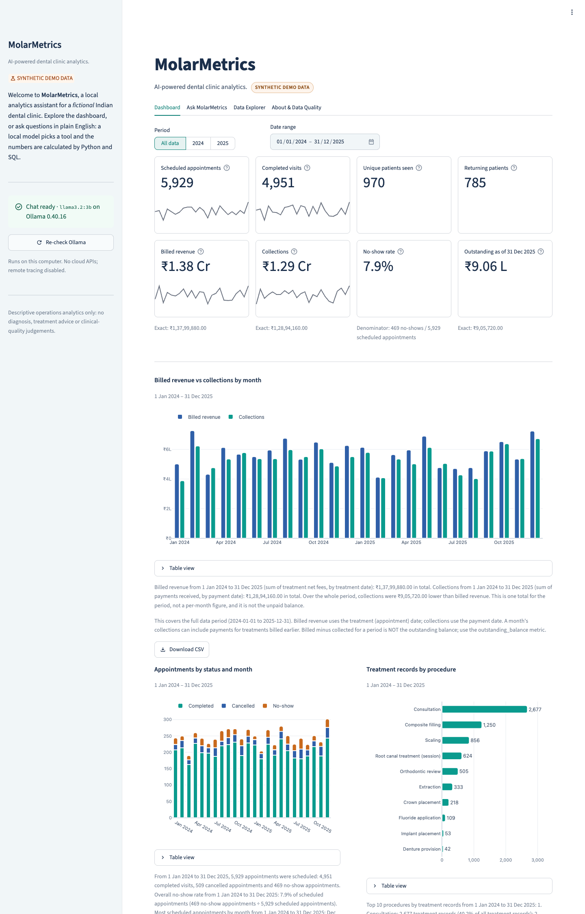
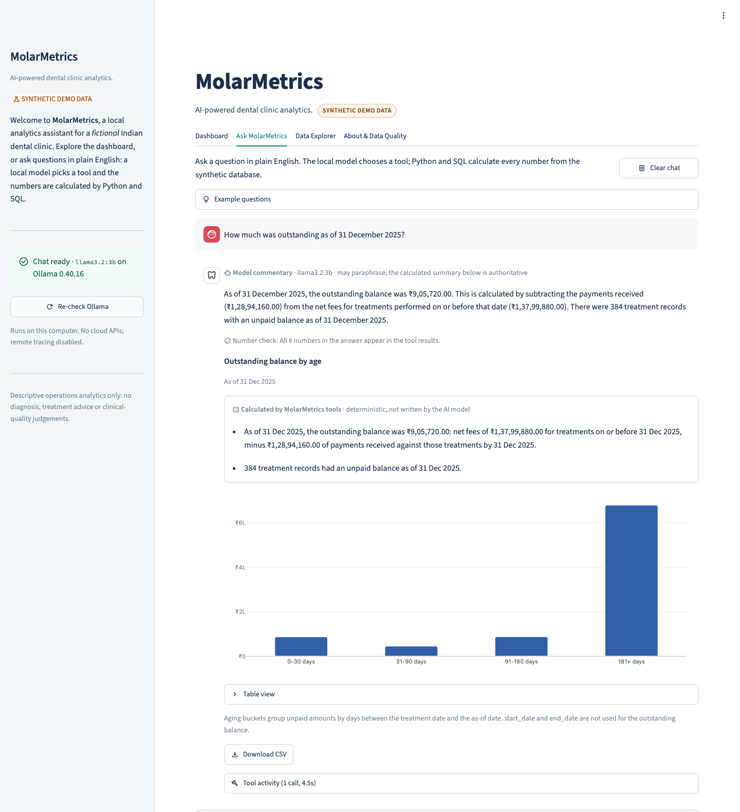
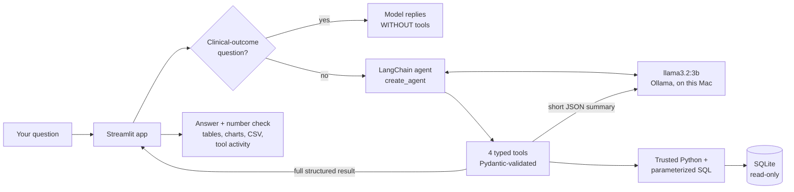

# MolarMetrics

**AI-powered dental clinic analytics.**

MolarMetrics is a **local portfolio prototype**: a dental-clinic operations analyst that answers
plain-English questions with a small language model running on your own computer. The model
(`llama3.2:3b` via [Ollama](https://ollama.com)) never does the maths. It *chooses* one of four
trusted analytics tools, Python and SQL calculate every number from a SQLite database, and the app
draws tables and charts directly from those structured results.

> ⚠️ **SYNTHETIC DEMO DATA.** Every patient, dentist, appointment, fee and payment describes a
> *fictional* Indian dental clinic. Fees are illustrative assumptions, not verified prices, and the
> patterns are not evidence about real clinics. MolarMetrics is descriptive operations analytics: it does
> **not** diagnose, recommend treatments, assess clinical quality or interpret dental images.

---

## Contents

1. [What it does](#what-it-does)
2. [Architecture and data flow](#architecture-and-data-flow)
3. [Why tools calculate the numbers, not the LLM](#why-tools-calculate-the-numbers-not-the-llm)
4. [The synthetic dataset](#the-synthetic-dataset)
5. [Metric definitions](#metric-definitions)
6. [Setup on a MacBook Air](#setup-on-a-macbook-air)
7. [Running the app](#running-the-app)
8. [Running the tests](#running-the-tests)
9. [Actual verification status](#actual-verification-status)
10. [Troubleshooting](#troubleshooting)
11. [Project structure](#project-structure)
12. [Future improvements (not implemented)](#future-improvements-not-implemented)

---

## What it does

The Streamlit app has four tabs:

| Tab | What you can do | Needs Ollama? |
|---|---|---|
| **Dashboard** | Date filter (All data / 2024 / 2025 / custom), 8 KPI tiles, billed revenue vs collections by month, appointments by status, top procedures, and no-show rate by month. Every chart has a table view and a CSV download. | No |
| **Ask MolarMetrics** | Chat in plain English. The model's wording is labelled **Model commentary**; each tool result opens with a separate **Calculated by MolarMetrics tools** box of deterministic sentences written by Python. Also: example-question buttons, supporting tables and Plotly charts, a **number check** under each answer, an expandable **tool activity** panel (tool name, the model's arguments, the validated arguments, and the exact result returned), CSV download and a clear-chat button. | Yes |
| **Data Explorer** | Browse all five tables, read the data dictionary, and download the synthetic CSVs. | No |
| **About & Data Quality** | Purpose, the synthetic-data notice, generation assumptions, metric definitions, validation results, live Ollama/model status, the last live-verification run, and known limitations. | No (shows status) |

| Dashboard (works without Ollama) | Ask MolarMetrics (real local model) |
|---|---|
|  |  |

*Screenshots of the running app, captured in Chrome on 10 Nov 2026. All figures are synthetic.*

Questions verified end to end against the real local model (see [verification](#actual-verification-status)):

1. What was billed revenue in 2025?
2. Compare monthly billed revenue and collections in 2025.
3. Which five procedures generated the most billed revenue in 2025?
4. What was the no-show rate by month in 2025?
5. How much was outstanding as of 31 December 2025?
6. Which dentist completed the most appointments in 2025?
7. How many returning patients were seen in 2025?
8. Compare root canal and extraction procedure counts in 2025.
9. Which treatment works best? *(correctly declined: no clinical outcome data)*
10. What was the average patient satisfaction score in 2025? *(correctly declined: not in the data)*
11. How much money was collected in 2025? *(probe for billed revenue / collections mix-ups)*

---

## Architecture and data flow



Step by step, for one question:

1. **Scope check** (`molarmetrics/agent/scope.py`). A narrow, rule-based check spots clinical
   outcome or quality questions such as "Which treatment works best?". For those, the model answers
   *without access to tools*, so it cannot present revenue as "best". These replies are labelled in the UI.
2. **The model chooses a tool.** `ChatOllama` (temperature 0) reads a short system prompt and four tool
   descriptions, then emits a structured tool call such as
   `analyze_finances(metric="outstanding_balance", as_of_date="2025-12-31")`.
3. **Arguments are validated** (`molarmetrics/analytics/params.py`). Harmless variations are normalised
   (`"2025"` → `2025-01-01 … 2025-12-31`, `"No-show rate"` → `no_show_rate`). Bad input is rejected with a
   message the model can act on: start date after end date, unknown metrics, `top_n` above 20,
   unknown procedures.
4. **Trusted code calculates** (`molarmetrics/analytics/metrics.py`, `analyses.py`), using parameterized
   SQL over a read-only connection. Money is summed as **integer paise**. Percentages, differences
   and "highest month" comparisons are computed in Python.
5. **Each tool returns two things**, via LangChain's `content_and_artifact`:
   * a **short JSON summary** for the model. Every metric states its **name, unit** (INR,
     appointments, patients, treatment records, payments, percent), **aggregation** (sum, count,
     distinct count, ratio, share, difference) and **date basis** (appointment date, payment date or
     as-of date), plus the explicit **date range**. It also carries **facts**: complete sentences
     written by Python that the model can quote. At most 24 rows; units are stated once per column.
   * the **full `AnalysisResult`** for the app (rows, definitions, warnings, chart metadata).
6. **The model writes a 2–4 sentence answer** built from those facts. The UI labels it **Model
   commentary** and shows the facts separately in a **Calculated by MolarMetrics tools** box. A
   **number check** flags any number in the prose that does not appear in the tool results.
7. **Charts and tables are drawn from the structured result** by fixed code in
   `molarmetrics/ui/charts.py`. The model's prose is never parsed for numbers, and no model-generated
   code is ever executed.

**Safety limits per question:** at most 4 model calls and 3 tool calls (LangChain middleware), a graph
recursion limit, a 120-second request timeout, and one retry only for transient server errors.
Users see friendly error messages; stack traces go to the terminal only.

**Privacy:** inference and analytics run on your Mac. LangSmith/LangChain remote tracing is forced
off at startup (`molarmetrics/config.py`). Streamlit usage statistics are disabled. The server binds to
`localhost` only, which also stops Streamlit's public-IP lookup. No cloud APIs are used.

---

## Why tools calculate the numbers, not the LLM

Language models predict plausible text; they do not reliably add 1,200 numbers or remember which date
a payment belongs to. A 3-billion-parameter model is especially prone to rounding, transposing or
inventing figures. So in MolarMetrics:

* **Python and SQL do all arithmetic**, including percentages, differences and rankings, with exact integer
  paise, and these calculations are covered by tests against hand-worked answers.
* **The model only chooses a tool and explains its output.** Tool results carry definitions, the period
  used, warnings, and pre-formatted values the model can quote verbatim.
* **The UI never trusts the prose.** Tables and charts come from the tool's structured rows, and the
  number check flags any figure in the answer that the tools did not produce.
* **The tool surface is deliberately small.** There are four fixed tools with enum arguments, and no
  arbitrary SQL, `eval`/`exec`, shell or file access.

---

## The synthetic dataset

Generated by `python -m molarmetrics.data.generate` with **seed 42**. The same seed and settings
reproduce **byte-identical** CSV files, and a test checks this.

| Table | Rows | Key columns |
|---|---|---|
| `patients` | 1,000 | `patient_id`, `birth_year`, `gender`, `locality` (invented), `registration_date` |
| `dentists` | 8 | `dentist_id`, `fictional_display_name`, `specialty` |
| `appointments` | 5,929 | `appointment_id`, `patient_id`, `dentist_id`, `appointment_datetime`, `status`, `visit_reason` |
| `treatments` | 6,667 | `treatment_id`, `appointment_id`, `procedure_name`, `tooth_number` (FDI), `listed_fee_inr`, `discount_inr`, `net_fee_inr` |
| `payments` | 6,893 | `payment_id`, `treatment_id`, `payment_date`, `amount_inr`, `payment_method` |

* **Period:** 1 Jan 2024 to 31 Dec 2025. **Currency:** INR, stored as integer **paise** (`*_paise`
  columns are authoritative; `*_inr` columns are derived for display and CSV).
* **No direct identifiers:** no patient names, phone numbers, emails or addresses. Dentist names and
  locality labels are invented.
* **How it is generated:** each patient gets a timeline of *care episodes* (check-ups, fillings, root
  canal courses, braces, dentures, implants…). Visits are booked into real 30-minute slots on each
  fictional dentist's working days, may end as no-shows or cancellations (often rebooked), and completed
  visits get treatment records and then 0–3 payments.
* **What one treatment record means:** one procedure line item at one completed visit. Root canal
  treatment is recorded **per session**, so counts are sessions, not teeth or completed courses. Some
  completed visits (reviews, try-ins) have no treatment record because they are included in another fee.
* **Modest, documented patterns (invented):** monsoon and festival-season dips, higher monsoon no-show
  rates, about 8% cancellations, discounts for seniors, waived consultations, split and partial
  payments, and instalments falling after 31 Dec 2025 that therefore show as outstanding.
* **Enforced rules:** primary and foreign keys; registration on or before the first appointment;
  treatments only on completed appointments; payments never exceed the net fee or precede the
  treatment; fees non-negative; discount ≤ listed fee; `net = listed − discount`; valid FDI teeth that
  are plausible for age; no double-booking. The database enforces these with constraints and triggers,
  and an **independent validator** re-checks them: `data/molarmetrics_validation_report.json` shows
  **36 of 36 checks passed**.

All assumptions live in [`molarmetrics/data/catalog.py`](molarmetrics/data/catalog.py). Full column
documentation is in [`data/molarmetrics_data_dictionary.md`](data/molarmetrics_data_dictionary.md).

**Limitations:** the data contains no clinical outcomes, diagnoses, imaging or quality measures.
Ages are approximate (visit year − birth year). Payments are linked to single treatments, which
simplifies real invoicing. Every pattern is invented.

---

## Metric definitions

| Metric | Definition |
|---|---|
| Scheduled appointments | All appointment records (completed, cancelled, no-show) dated within the range. |
| Completed visits | Appointments with status `completed` within the range. |
| No-show rate | No-shows ÷ **all** scheduled appointments in the same period; the denominator is always shown. |
| Unique patients seen | Distinct patients with at least one completed visit in the range. |
| Returning patients | Distinct patients seen in the range who had an **earlier** completed visit, looking back through all history (including before the range). |
| Billed revenue | Sum of treatment **net fees**, by appointment (treatment) date. Money charged, not received. |
| Collections | Sum of payments, by **payment** date. Money received, possibly for earlier treatments. |
| Outstanding balance (as of D) | Net fees for treatments on or before D, minus payments against those treatments on or before D. |
| Treatment count | Number of treatment records (line items), not patients or courses. |

Double counting is prevented by aggregating treatments and payments **separately** before combining
them. Months are always chronological and zero-filled, and zero denominators give `n/a` with a warning.

---

## Setup on a MacBook Air

Tested on a MacBook Air (Apple M2, 8 GB RAM), macOS 15, Python 3.13.5, Ollama 0.40.16.

**1. Open the project folder in Terminal** (or the VS Code terminal):

```bash
cd ~/Desktop/MolarMetrics
```

**2. Create and activate the project's own virtual environment.** This was already done for this
project; skip it if `.venv/` exists. If your prompt shows `(base)` from Anaconda, that is fine:
activating `.venv` takes priority.

```bash
/Library/Frameworks/Python.framework/Versions/3.13/bin/python3.13 -m venv .venv   # only if .venv is missing
source .venv/bin/activate
which python          # should end in MolarMetrics/.venv/bin/python
```

In VS Code: **Cmd+Shift+P → "Python: Select Interpreter" → `.venv`**.

**3. Install the pinned dependencies** (into `.venv`, never globally):

```bash
python -m pip install -r requirements.txt
```

**4. Optional settings:** the defaults already match this setup.

```bash
cp .env.example .env
```

### Start Ollama and configure the model

```bash
ollama serve            # or simply open the Ollama app; "address already in use" means it is already running
ollama list             # llama3.2:3b should be listed
ollama pull llama3.2:3b # only if it is missing (about 2 GB)
```

MolarMetrics reads `OLLAMA_MODEL` (default `llama3.2:3b`) and `OLLAMA_BASE_URL` (default
`http://localhost:11434`) from the environment or `.env`. No other model is downloaded or used.

### Generate (or regenerate) the synthetic data

The data is already generated in `data/`. To regenerate it from scratch:

```bash
python -m molarmetrics.data.generate              # refuses to overwrite existing files
python -m molarmetrics.data.generate --overwrite  # regenerate in place (same seed = identical CSVs)
python -m molarmetrics.data.validate              # re-run the validation checks on the database
```

---

## Running the app

```bash
source .venv/bin/activate
streamlit run app.py
```

Open **http://localhost:8501**. The Dashboard, Data Explorer and About tabs work even when Ollama is
off; the chat tab then shows exactly which command to run.

Ask from the terminal (handy for checking the model works):

```bash
python scripts/ask.py "How much was outstanding as of 31 December 2025?"
```

---

## Running the tests

```bash
python -m pytest                  # 182 offline tests (no Ollama needed), about 5 seconds
python -m pytest -m integration   # LIVE tests against the real local model (needs Ollama)

python scripts/smoke_test_tool_calling.py   # Stage 1: minimal real tool-calling proof
python scripts/run_integration_checks.py    # live checks + report in reports/integration_report.md
```

What the offline tests cover:

* **Reproducibility.** The same seed gives identical tables, and the shipped CSVs match a fresh seed-42 run.
* **Integrity.** Primary and foreign keys, double-booking, and the cross-table triggers. The database
  rejects 14 kinds of bad row, and the independent validator catches rule breaks even with the triggers
  switched off.
* **Financial arithmetic.** These use a **hand-calculated fixture** (`tests/fixtures/mini_clinic.py`) and
  cover multiple treatments per visit, split payments without double counting, appointment-date vs
  payment-date filtering, outstanding balances at six as-of dates, paise exactness, no-show
  denominators including cancellations, returning patients using history before the window, and
  empty periods.
* **Real-data cross-check.** Every priority question's numbers are compared with an independent
  **pandas** calculation on the CSV files.
* **Tools.** Invalid arguments (inside the real agent loop, via a scripted model), read-only database
  access, sanitised database text, and friendly errors without stack traces.
* **Explicit tool metadata.** Every number declares a unit and aggregation; every result has a date range
  and facts; facts never say "average" or "majority"; the top-N combined share is hand-checked (90.9% on
  the fixture) and matches pandas on real data (71.6%); the largest model JSON stays under 7 KB.
* **Wording regression checks** (`tests/integration/wording_checks.py`, tested in
  `tests/test_wording_checks.py`). They flag four error types:
  * a total described as an average;
  * "majority" without a calculated share above 50%;
  * patients, appointments, treatment records and payments mixed up;
  * billed revenue and collections swapped.

  The documented bad answers **are** flagged, and correct real answers from the live runs are **not**.
  Facts copied verbatim pass every check.
* **Grounding check, scope check, and app smoke test.** The app runs with no exceptions and stays usable
  without Ollama.

Mocked or scripted-model tests are **not** proof that the real agent works; that is what the live
integration checks are for.

---

## Actual verification status

Recorded on **10 Nov 2026** on the MacBook Air described above:

| Check | Result |
|---|---|
| Stage 1 smoke test (real tool calling) | **PASS.** `llama3.2:3b` called `count_appointments(status="completed")`, the tool returned 7 from the fixture, and the model answered "There are 7 completed appointments in the database." (`reports/stage1_smoke_test.json`) |
| Dataset validation | **PASS, 36/36 checks** (`data/molarmetrics_validation_report.json`) |
| Reproducibility | **PASS.** Seed 42 regenerates byte-identical CSVs. |
| Offline test suite | **182 passed**, 0 failed |
| Live end-to-end (real Ollama), demo-readiness pass | Three runs of the 11-question suite (5 priority questions + 6 extras), each checking: right tool, right arguments, tool numbers equal to independent pandas calculations, key figure stated, every number grounded, and the four wording checks.<br>**Run 1: 10/11, priority 5/5.** E6 was marked FAIL, but the model's answer was correct: my E6 criterion wrongly rejected any mention of billed revenue, even correctly labelled. The criterion was fixed; the dedicated swap check already covers the real risk.<br>**Run 2: 11/11, priority 5/5** (`reports/integration_report.md`).<br>**Run 3 (`pytest -m integration`): 11/11.**<br>Warm answers took 2–11 s; the first question after the model loads takes longer. |
| Streamlit | Starts with no errors. `AppTest` shows no exceptions, with and without Ollama. **Visually checked** in real Chrome (via Playwright) at 1440 px and 390 px wide: dashboard, chat answer with chart and tool activity, data explorer, and about page, with no browser console errors. After the demo-readiness pass, the two changed screens were re-checked: the chat (labelled **Model commentary** + **Calculated by MolarMetrics tools** box) and the dashboard (facts under each chart). |

**Honest caveats from the live runs:**

* **Wording errors found earlier and fixed in this pass.** Each now has an automated regression check,
  and none recurred in the three runs above:
  * Q2 called a yearly total "on average". It now says "collected less than it billed".
  * Q3 claimed "the majority" without a calculated share. It now quotes the tool's computed 71.6%.
  * E3 called a difference in records "123 more patients". It now says "123 more treatment records".
* **Remaining observations no check flags:**
  * Q2 is asked "monthly", but its prose summarises the **yearly totals**; the month-by-month
    breakdown is in the chart and table.
  * E5's refusal mentions an internal tool name.
  * Wording varies slightly between runs, even at temperature 0. The calculated facts do not.
* **What the checks can't do.** The wording checks are targeted heuristics for the four error types
  above. They cannot judge every phrase. The calculated summary, table and chart under each answer
  are the authoritative figures.
* **Earlier fixes (before this pass):** "Which treatment works best?" ranked revenue (fixed with the
  scope check), and a 120-character limit had been cutting off the comparison sentence the model
  received (fixed).
* **Scope of the evidence.** These results come from one model at temperature 0 on these exact
  phrasings. Rephrased questions can behave differently.

---

## Troubleshooting

| Symptom | Fix |
|---|---|
| Chat says *Ollama is not reachable* | Run `ollama serve` (or open the Ollama app), then click **Re-check Ollama** in the sidebar. |
| *Model llama3.2:3b is not installed* | `ollama pull llama3.2:3b`, then re-check. |
| First answer is slow (15–30 s) | The model is loading into memory. Later answers are faster. Close memory-heavy apps on an 8 GB Mac. |
| *The model did not respond within 120 seconds* | Retry once. If it persists, increase `OLLAMA_TIMEOUT_SECONDS` in `.env`, or lower `OLLAMA_NUM_CTX` to 4096. |
| *Database not found* | `python -m molarmetrics.data.generate` |
| `ModuleNotFoundError` | Activate the venv (`source .venv/bin/activate`) and run commands from the project folder. |
| Streamlit asks for an email on first run | Press Enter to skip. |
| Port 8501 busy | `streamlit run app.py --server.port 8502` |
| The app does not open from another device | Intentional: it only listens on `localhost`, because it has no login. |
| An answer's number check shows ⚠️ | The model wrote a number that is not in the tool results. Trust the table and chart below it. |

---

## Project structure

```
MolarMetrics/
├── app.py                         Streamlit entry point (4 tabs)
├── molarmetrics/
│   ├── config.py                  settings (.env), forces remote tracing off
│   ├── money.py                   integer paise, INR formatting (Indian digit grouping)
│   ├── data/
│   │   ├── catalog.py             ALL synthetic-data assumptions (fees, dentists, patterns)
│   │   ├── generate.py            seeded generator + CLI (--overwrite)
│   │   ├── schema.py              SQLite schema: keys, CHECKs, unique indexes, triggers
│   │   ├── validate.py            independent validation → JSON report
│   │   └── dictionary.py          data dictionary (Markdown + CSV)
│   ├── analytics/
│   │   ├── params.py              Pydantic argument models (validation + normalisation)
│   │   ├── metrics.py             parameterized SQL metric functions
│   │   ├── analyses.py            the four analyses → AnalysisResult
│   │   ├── results.py             structured result, model-facing JSON, formatting
│   │   ├── definitions.py         metric definitions (single source of truth)
│   │   └── db.py                  read-only SQLite connection
│   ├── agent/
│   │   ├── tools.py               the four LangChain tools
│   │   ├── agent.py               ChatOllama + create_agent + limits + error handling
│   │   ├── prompts.py             system prompt
│   │   ├── scope.py               clinical-outcome scope check
│   │   ├── grounding.py           number grounding check
│   │   └── ollama_status.py       Ollama/model availability check
│   └── ui/                        dashboard, chat, explorer, about, charts, theme
├── data/                          generated CSVs, SQLite DB, dictionary, validation report
├── docs/screenshots/              screenshots of the running app (used in this README)
├── reports/                       Stage 1 and live integration reports
├── scripts/                       smoke test, live checks, terminal "ask"
├── tests/                         offline tests, hand-checked fixture, live integration tests
├── requirements.txt               pinned direct dependencies
├── requirements-lock.txt          full pinned environment snapshot
├── DEMO.md                        two-minute portfolio demo script
└── .env.example, .gitignore, .streamlit/config.toml, pyproject.toml
```

---

## Future improvements (not implemented)

These are **ideas only**; none of them exist in this prototype:

* Period-over-period comparisons computed by a tool (e.g. 2025 vs 2024 change), so the model never needs to subtract.
* An evaluation set of many rephrased questions, to measure tool-selection accuracy across wordings.
* Trying a larger local model alongside `llama3.2:3b`, with the same live checks.
* Treatment-course grouping (linking a root canal's sessions and crown into one course).
* Invoice-level payments, refunds and insurance, closer to real clinic billing.
* Authentication, audit logging and deployment hardening, which a real clinic would need before any use with real data.
